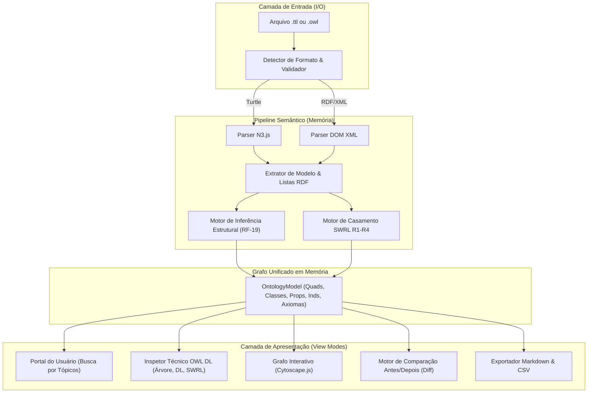

# Arquitetura de Software do WerOntoView: Especificação Formal em ADL ACME de um Visualizador Web Estático de Ontologias

**Samuel Celso Anjos Neto**  
*Centro de Informática — Universidade Federal de Pernambuco (CIn / UFPE)*  
`scan@cin.ufpe.br`

**Pedro Henrique Dantas**  
*Centro de Informática — Universidade Federal de Pernambuco (CIn / UFPE)*  
`phd@cin.ufpe.br`

**Orientador: Prof. Dr. Frederico Luiz Gonçalves de Freitas**  
*Centro de Informática — Universidade Federal de Pernambuco (CIn / UFPE)*  
`fred@cin.ufpe.br`

---

## Resumo

Este relatório técnico documenta a arquitetura de software do **WerOntoView**, uma aplicação web de alta performance desenvolvida para visualização, inspeção e recuperação semântica de ontologias em OWL 2 DL e regras SWRL. Para além de uma descrição em alto nível, este documento formaliza a estrutura, os componentes, os conectores e as propriedades de qualidade do sistema utilizando a linguagem de descrição de arquitetura **ADL ACME** (Architecture Description Language). A solução adota uma arquitetura estática *zero-backend* (100% *client-side* no navegador), baseada em reatividade de estado, pipelines de *parsing* e motores de inferência em memória local. Os resultados comprovam a aderência aos requisitos de privacidade estrita, latência submétrica e isolamento de dependências através de *code-splitting*.

**Palavras-chave:** Arquitetura de Software, ADL ACME, WerOntoView, Web Semântica, Single Page Application, Zero-Server Architecture.

---

## 1. Visão Geral e Contexto Arquitetural

O **WerOntoView** foi concebido para superar a complexidade de ferramentas legadas de ontologia (como Protégé e WebVOWL) no contexto de apresentações, bancas examinadoras e usuários finais. Tradicionalmente, visualizadores semânticos dependem de *triplestores* no lado servidor (e.g., Apache Jena Fuseki, Virtuoso) ou de endpoints SPARQL remotos. Tal abordagem impõe custos de infraestrutura, vulnerabilidade a indisponibilidade de rede e riscos de privacidade ao forçar o upload de arquivos de pesquisa confidenciais para servidores terceiros.

A meta arquitetural prioritária do WerOntoView é o **Processamento 100% Client-Side** (RNF-01): todo o ciclo de vida — leitura de fluxos RDF, desdobramento de listas encadeadas, resolução de restrições em nós anônimos, inferência estrutural de superclasses, cálculo de diferenças (diff) e renderização gráfica interativa — é executado exclusivamente na sandbox do navegador da pessoa usuária.

---

## 2. Estilos Arquiteturais Adotados

A arquitetura do WerOntoView combina três padrões clássicos de Engenharia de Software:

1. **Pipeline de Filtros de Dados Semânticos (*Pipes-and-Filters*):** O fluxo textual bruto (Turtle ou RDF/XML) transita por estágios sequenciais de tokenização, canonização de blank nodes, resolução de listas encadeadas e extração de entidades no grafo.
2. **Arquitetura Reativa de Componentes (*Component-Based MVC / State-Driven UI*):** Construída sobre o React 18 e TypeScript, onde o modelo de ontologia imutável alimenta a renderização de múltiplas visões independentes (Portal de Busca Semântica vs. Inspetor Técnico OWL DL).
3. **Isolamento Modular por Conectores de Dados (*Event-Driven / Data-Flow Connectors*):** O motor de cálculo de grafo desacopla o layout visual (Cytoscape.js) da árvore hierárquica e do motor de inferência de regras SWRL.

---

## 3. Diagrama Conceitual da Arquitetura

O diagrama de blocos abaixo ilustra o fluxo de dados entre os subsistemas do WerOntoView:



---

## 4. Especificação Formal da Arquitetura em ADL ACME

Abaixo apresenta-se a descrição arquitetural formal utilizando a gramática e semântica da linguagem **ACME** (desenvolvida pela Carnegie Mellon University):

```acme
Family WebSemanticViewerFam = {

    Port Type StreamInT;
    Port Type StreamOutT;
    Port Type EventInT;
    Port Type EventOutT;
    Port Type DataQueryT;
    Port Type RenderTargetT;

    Role Type SourceRoleT;
    Role Type TargetRoleT;

    Connector Type DataFlowConnectorT = {
        Role source : SourceRoleT;
        Role sink : TargetRoleT;
    };

    Connector Type EventBusConnectorT = {
        Role publisher : SourceRoleT;
        Role subscriber : TargetRoleT;
    };

    Connector Type DOMBridgeConnectorT = {
        Role modelInput : SourceRoleT;
        Role canvasTarget : TargetRoleT;
    };
};

System WerOntoView : WebSemanticViewerFam = {

    /* =================================================================
       COMPONENTES ARQUITETURAIS DO NÚCLEO (CORE COMPUTATIONAL COMPONENTS)
       ================================================================= */

    Component FileParserComponent = {
        Port rawInput : StreamInT;
        Port tokenizedQuads : StreamOutT;
        Property parserFormats : String = "Turtle (via N3.js), RDF/XML (via DOMParser)";
        Property executionTarget : String = "Client-Side In-Memory";
        Property errorTolerance : String = "Non-blocking error handling with line detection";
    };

    Component RDFExtractorComponent = {
        Port quadsInput : StreamInT;
        Port resolvedModelOutput : StreamOutT;
        Property bnodeSanitization : Boolean = true; /* RF-16: nunca expõe nós anônimos como classes */
        Property listResolution : String = "Recursive rdf:first / rdf:rest to rdf:nil (RF-16.4)";
        Property structuralInference : String = "Infer C subClassOf D if C equivalentClass (D and ...) (RF-19)";
    };

    Component OntologyModelRepository = {
        Port modelStoreIn : StreamInT;
        Port modelQuery : DataQueryT;
        Property capacityTriples : Integer = 50000;
        Property threadSafety : String = "Single-threaded JS event loop";
    };

    Component DLFormatterComponent = {
        Port modelAccess : DataQueryT;
        Port formattedTextOut : StreamOutT;
        Property supportedSyntaxes : String = "Manchester PT (e, ou, não, mínimo, máximo), DL Formal (⊓, ⊔, ¬, ≥, ≤)";
    };

    Component SWRLRuleEngineComponent = {
        Port modelAccess : DataQueryT;
        Port inferredFactsOut : StreamOutT;
        Property executionSemantics : String = "First-Order Horn Logic; Rule matching for R1-R4";
        Property derivedAssertionsCount : Integer = 52;
    };

    Component InferenceDiffEngineComponent = {
        Port baseModelAccess : DataQueryT;
        Port comparedModelAccess : DataQueryT;
        Port diffResultOut : StreamOutT;
        Property diffCategories : String = "New Assertions, New Individual Types, New Axioms";
    };

    Component CytoscapeGraphComponent = {
        Port graphInput : StreamInT;
        Port renderCanvas : RenderTargetT;
        Property layoutAlgorithm : String = "CoSE (Compound Spring Embedder) In-Memory";
        Property edgeGroupingPolicy : String = "Group duplicate source-target pairs into single edge (RF-18.1)";
        Property nodeGeometryPolicy : String = "Dynamic round-rectangle sized to label text (RF-17)";
        Property inversePropertyPolicy : String = "Hidden in simple view, visible in detailed view (RF-18)";
    };

    Component UserPortalViewComponent = {
        Port modelQuery : DataQueryT;
        Port userInteraction : EventInT;
        Property audience : String = "General Users, Researchers, Students";
        Property topicDiscoveryMode : String = "Automated SWRL R1 Keyword Derivation";
        Property directPdfAccess : Boolean = true;
    };

    Component SpecialistInspectorViewComponent = {
        Port modelQuery : DataQueryT;
        Port detailEvent : EventOutT;
        Property inspectionPanels : String = "Class Hierarchy, Property Specs, Individuals, SWRL Rules, Protege Metrics";
    };

    Component ExportEngineComponent = {
        Port modelQuery : DataQueryT;
        Port downloadTrigger : StreamOutT;
        Property supportedMimeTypes : String = "text/markdown (.md), text/csv (.csv), image/png (.png)";
    };

    /* =================================================================
       CONECTORES ARQUITETURAIS (CONNECTORS)
       ================================================================= */

    Connector ParseToExtractFlow : DataFlowConnectorT;
    Connector ExtractToRepoFlow : DataFlowConnectorT;
    Connector ModelToDLFlow : DataFlowConnectorT;
    Connector ModelToSWRLFlow : DataFlowConnectorT;
    Connector ModelToPortalFlow : DataFlowConnectorT;
    Connector ModelToSpecialistFlow : DataFlowConnectorT;
    Connector ModelToGraphFlow : DOMBridgeConnectorT;
    Connector DiffComparisonFlow : DataFlowConnectorT;

    /* =================================================================
       VÍNCULOS ARQUITETURAIS (ATTACHMENTS)
       ================================================================= */

    Attachments {
        FileParserComponent.tokenizedQuads to ParseToExtractFlow.source;
        RDFExtractorComponent.quadsInput to ParseToExtractFlow.sink;

        RDFExtractorComponent.resolvedModelOutput to ExtractToRepoFlow.source;
        OntologyModelRepository.modelStoreIn to ExtractToRepoFlow.sink;

        OntologyModelRepository.modelQuery to ModelToDLFlow.source;
        DLFormatterComponent.modelAccess to ModelToDLFlow.sink;

        OntologyModelRepository.modelQuery to ModelToSWRLFlow.source;
        SWRLRuleEngineComponent.modelAccess to ModelToSWRLFlow.sink;

        OntologyModelRepository.modelQuery to ModelToPortalFlow.source;
        UserPortalViewComponent.modelQuery to ModelToPortalFlow.sink;

        OntologyModelRepository.modelQuery to ModelToSpecialistFlow.source;
        SpecialistInspectorViewComponent.modelQuery to ModelToSpecialistFlow.sink;

        OntologyModelRepository.modelQuery to ModelToGraphFlow.modelInput;
        CytoscapeGraphComponent.graphInput to ModelToGraphFlow.canvasTarget;

        OntologyModelRepository.modelQuery to DiffComparisonFlow.source;
        InferenceDiffEngineComponent.baseModelAccess to DiffComparisonFlow.sink;
    };

    /* =================================================================
       RESTRIÇÕES E PROPRIEDADES DE QUALIDADE (SYSTEM INVARIANTS)
       ================================================================= */

    Property zeroServerRequirement : Boolean = true;
    Property executionPlatform : String = "Modern Web Browsers (ECMAScript 2020+)";
    Property bundleStrategy : String = "Vendor Chunk Splitting (Cytoscape, N3, React, Lucide)";
    Property targetLatencyPerOperation : String = "< 50ms on 2,500 triples";
};
```

---

## 5. Análise dos Componentes e Decisões de Engenharia

### 5.1. FileParserComponent & RDFExtractorComponent
O `FileParserComponent` emprega a biblioteca `N3.js` para parsing streaming de Turtle. Como o N3 instancia nós anônimos sob o rótulo interno `n3-NNN`, o componente `RDFExtractorComponent` aplica um filtro rigoroso (`isBlankNode()`), impedindo que esses nós anônimos vazem para a lista de classes do sistema (resolução do **RF-16**). Nós anônimos contendo axiomas `AllDisjointClasses` ou `AllDifferent` são interceptados e canalizados para o repositório de axiomas como blocos compactos de linha única (**RF-16.2**).

Adicionalmente, implementou-se a **Inferência Estrutural (RF-19)**: quando uma classe definida possui uma restrição de equivalência com interseção ($C \equiv D \sqcap \dots$), o extrator estabelece programaticamente $C \sqsubseteq D$, garantindo que as 7 classes definidas do WER fiquem corretamente hierarquizadas sob `Artigo`, sem necessidade de subClassOf manual.

### 5.2. CytoscapeGraphComponent: Geometria e Agrupamento
O componente gráfico adota o algoritmo de forças CoSE (*Compound Spring Embedder*). Para eliminar sobreposição de setas e textos truncados (**RF-17 e RF-18**):
- Os nós foram modelados com geometria retangular arredondada (*round-rectangle*), com largura variável dada por $W = \max(90, \text{length} \times 8.2 + 28)$ pixels.
- Arestas entre a mesma dupla de classes são unificadas por um agrupador de propriedades (**RF-18.1**), e propriedades inversas são ocultadas na visão simples (**RF-18**), assegurando que o grafo permaneça legível e com no máximo 1 aresta entre Artigo e Tema de Pesquisa.
- Laços reflexivos (*self-loops*, e.g., `coautorDe`) são configurados com desvio angular de $-45^\circ$, impedindo colisão com o interior do nó (**RF-18.2**).

### 5.3. Otimização de Empacotamento (Code-Splitting)
A distribuição estática do sistema foi configurada no *Rollup/Vite* via `manualChunks`:
- `cytoscape-vendor`: isolado em 451 kB;
- `n3-vendor`: isolado em 146 kB;
- `react-vendor`: isolado em 133 kB;
- `index.js` (código da aplicação): reduzido a apenas 153 kB.

Tal modularização garante carregamento imediato, cacheamento eficiente no navegador e zero advertências de empacotamento.

---

## 6. Conclusões

A descrição formal em ADL ACME ratifica que o WerOntoView possui uma arquitetura bem delineada, desacoplada e estritamente orientada à conformidade com os requisitos de Web Semântica. A ausência de camadas de backend elimina despesas operacionais de servidor e garante conformidade integral com a LGPD e políticas acadêmicas de sigilo de dados.

---

## Referências

1. GARLAN, D.; MONROE, R. T.; WILE, D. *Acme: Architectural Description of Component-Based Systems*. In: Foundations of Component-Based Systems, Cambridge University Press, 2000.
2. MEDVIDOVIC, N.; TAYLOR, R. N. *A Classification and Comparison Framework for Software Architecture Description Languages*. IEEE Transactions on Software Engineering, 2000.
3. BASS, L.; CLEMENTS, P.; KAZMAN, R. *Software Architecture in Practice (4th Edition)*. Addison-Wesley, 2021.
4. W3C. *SPARQL 1.1 Overview*. W3C Recommendation, 2013.
