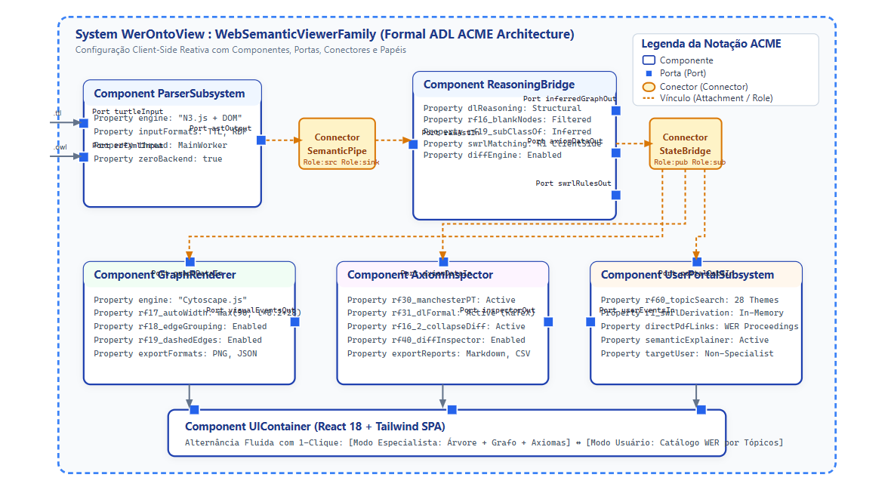
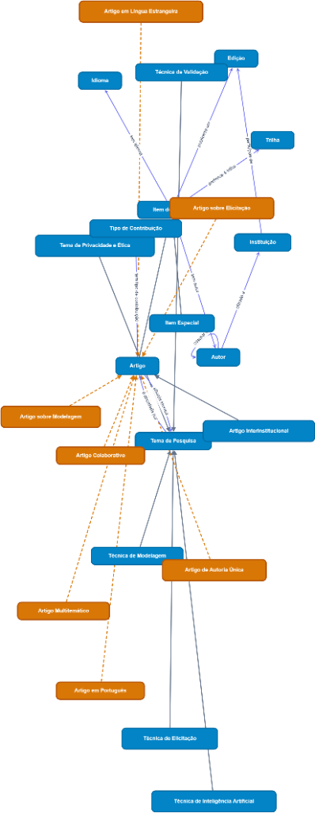
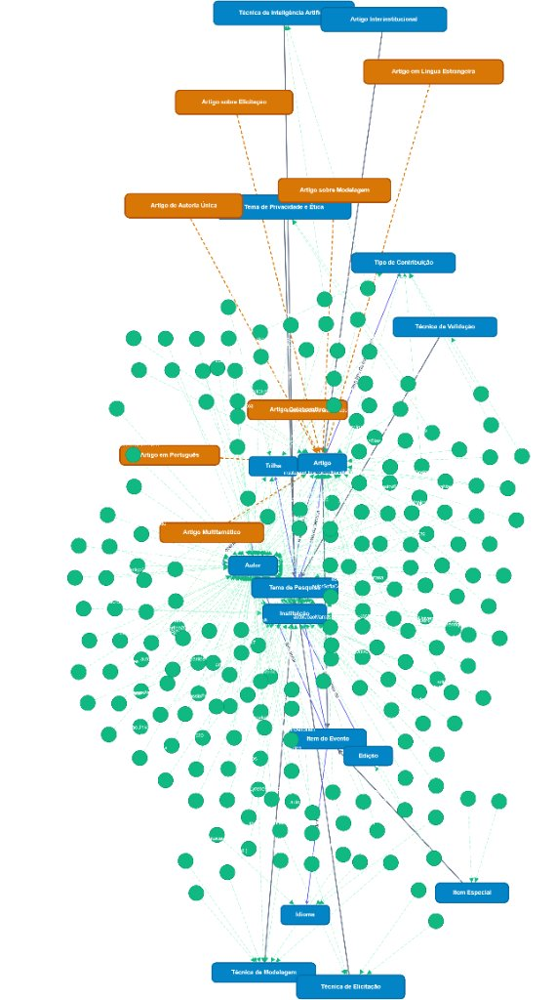

# Modelagem Ontológica em OWL 2 DL e Inferência SWRL no Catálogo de Publicações do WER 2026: Concepção Teórica, Avaliação Empírica e Operacionalização via Ferramenta WerOntoView

**Samuel Celso Anjos Neto**  
*Centro de Informática — Universidade Federal de Pernambuco (CIn / UFPE)*  
`scan@cin.ufpe.br`

**Pedro Henrique Dantas**  
*Centro de Informática — Universidade Federal de Pernambuco (CIn / UFPE)*  
`phd@cin.ufpe.br`

**Orientador: Prof. Dr. Frederico Luiz Gonçalves de Freitas**  
*Centro de Informática — Universidade Federal de Pernambuco (CIn / UFPE)*  
`fred@cin.ufpe.br`

---

## Resumo

A disseminação de produção científica em fóruns especializados demanda soluções computacionais que transcendam a recuperação puramente sintática de palavras-chave. No âmbito do *Workshop on Requirements Engineering (WER)* — principal fórum ibero-americano de Engenharia de Requisitos —, este artigo apresenta a concepção, especificação formal e validação empírica da **Ontologia do Catálogo de Publicações do WER 2026**, integrada à sua operacionalização prática através da ferramenta web **WerOntoView**. Modelada sob o padrão formal **OWL 2 DL** ($\mathcal{SROIQ}^{(D)}$) e enriquecida com regras semânticas em **SWRL (Semantic Web Rule Language)**, a ontologia estrutura o ecossistema científico do evento composto por **2.584 triplas RDF**, interligando artigos científicos, pesquisadores, afiliações institucionais, tópicos de pesquisa, trilhas e proceedings. Demonstra-se como axiomas de lógica de descrições — tais como classes definidas por equivalência com restrições de cardinalidade qualificada e composições de papéis via cadeias de propriedades — integrados a quatro regras SWRL de primeira ordem executadas em motor Drools, viabilizam a descoberta automatizada de **52 novas asserções de técnicas abordadas**, **58 correlações temáticas**, **33 participações institucionais** e a classificação de **20 publicações interinstitucionais**. Como extensão e suporte operacional a esse artefato ontológico, desenvolveu-se a ferramenta **WerOntoView**, concebida a partir de uma rigorosa **Engenharia de Requisitos** (baseada na norma IEEE 830 / ISO 29148) que solucionou desafios críticos de visualização como a eliminação de nós anônimos soltos, ajuste dinâmico de rótulos e inferência estrutural de superclasses. A arquitetura de software da ferramenta foi formalizada na linguagem de descrição arquitetural **ADL ACME** em uma topologia 100% estática (*zero-backend*), provendo visualização em grafo interativo, tradução bidirecional de axiomas (Manchester PT $\leftrightarrow$ DL formal), análise diferencial pré/pós-inferência (*Diff*) e um portal simplificado de recuperação de artigos voltado ao usuário leigo. Os resultados atestam a robustez do modelo formal e a eficácia da ferramenta na democratização do acesso ao conhecimento ontológico.

**Palavras-chave:** Web Semântica, Ontologia OWL 2 DL, Regras SWRL, Lógica de Descrições $\mathcal{SROIQ}^{(D)}$, Engenharia de Requisitos, Arquitetura ADL ACME, Catálogo WER, Inferência Semântica, WerOntoView.

---

## 1. Introdução

A gestão e recuperação de literatura acadêmica em simpósios e conferências especializadas constitui um desafio clássico na Ciência da Computação. Mecanismos convencionais de indexação baseados em tabelas relacionais ou motores de busca textual (como busca booleana por strings exatas) sofrem de limitações intrínsecas decorrentes de polissemia, sinonímia e da incapacidade de deduzir relações conceituais implícitas. No contexto da Engenharia de Requisitos (ER), o *Workshop on Requirements Engineering (WER)* congrega há quase três décadas artigos, tutoriais e palestras nos idiomas português, espanhol e inglês. Uma busca tradicional pelo termo *"Non-Functional Requirements"* costumeiramente falha em recuperar artigos hispânicos catalogados sob *"Requerimientos No Funcionales"* ou produções em português rotuladas como *"Requisitos Não-Funcionais"*, além de não derivar automaticamente a rede de coautoria entre pesquisadores ou a colaboração científica entre instituições geograficamente dispersas.

Para solucionar essas deficiências por meio das tecnologias da **Web Semântica**, o presente trabalho tem como foco principal a concepção, axiomatização e validação da **Ontologia do Catálogo WER 2026 (versão 7)**. A ontologia fornece um modelo conceitual rigoroso, fundamentado em Lógica de Descrições (DL) e regras de produção em SWRL, permitindo que computadores executem raciocínio dedutivo sobre os dados de publicação.

Adicionalmente, como contribuição complementar de engenharia de software e operacionalização da ontologia, apresenta-se a ferramenta **WerOntoView**. Reconhecendo que ferramentas tradicionais como o Protégé apresentam elevada curva de aprendizado e interfaces sobrecarregadas que dificultam avaliações em bancas e o uso por pesquisadores não-especialistas, o WerOntoView foi concebido como um ambiente visual moderno, 100% executado no navegador (*client-side*), capaz de processar a ontologia, exibir suas inferências, traduzir axiomas para linguagem natural e permitir a busca semântica por tópicos em um subsite simplificado.

O artigo está organizado da seguinte forma: a Seção 2 apresenta a Engenharia de Requisitos da ferramenta e a solução de problemas de usabilidade visual; a Seção 3 detalha a metodologia de desenvolvimento ontológico e as Questões de Competência; a Seção 4 expõe a conceitualização e vocabulário ontológico; a Seção 5 formaliza a axiomatização em Lógica de Descrições ($\mathcal{SROIQ}^{(D)}$); a Seção 6 apresenta a base de regras semânticas em SWRL; a Seção 7 descreve a avaliação experimental e os resultados de inferência; a Seção 8 detalha a operacionalização semântica, o diagrama arquitetural em ADL ACME e as visualizações da ferramenta; e a Seção 9 apresenta as conclusões e trabalhos futuros.

---

## 2. Engenharia de Requisitos da Ferramenta WerOntoView

Para que a ontologia do WER pudesse ser explorada, verificada e disseminada com eficácia, a concepção da ferramenta **WerOntoView** foi guiada pelas diretrizes das normas **IEEE 830-1998** e **ISO/IEC/IEEE 29148:2018** (Engenharia de Requisitos). A ferramenta foi desenhada para atender a dois perfis de usuários com objetivos distintos:

1. **Perfil Especialista / Avaliador:** Pesquisadores de Web Semântica, professores e membros de bancas que necessitam auditar formalmente a ontologia, inspecionar axiomas em Lógica de Descrições, verificar a hierarquia de classes, analisar variáveis de regras SWRL e inspecionar a rede relacional no grafo.
2. **Perfil Usuário Comum / Estudante:** Alunos de graduação e profissionais que desejam localizar artigos sobre técnicas específicas de Engenharia de Requisitos no catálogo do WER 2026, acessar diretamente os arquivos PDF nos proceedings e compreender de forma didática por que um artigo foi associado a um determinado tema.

### 2.1. Requisitos Funcionais Essenciais do Sistema

A Tabela 1 lista os principais Requisitos Funcionais (RF) especificados e implementados na ferramenta:

| ID | Prioridade | Requisito | Solução Técnica Adotada no WerOntoView |
| :--- | :--- | :--- | :--- |
| **RF-01** | Deve | Upload e Drag-and-drop de arquivos Turtle e RDF/XML | Parser polimórfico com detecção automática por assinatura de conteúdo. |
| **RF-03** | Deve | Carregamento de exemplo embutido | Carga assíncrona imediata da ontologia oficial do WER 2026 (`wer-catalogo-v7-regras-swrl.ttl`). |
| **RF-11** | Deve | Hierarquia de classes em árvore retrátil | Componente `ClassTree` com contadores de instâncias e badges para classes definidas. |
| **RF-15** | Deve | Grafo conceitual interativo | Renderização via Cytoscape.js com suporte a zoom, pan, destaque de vizinhança e exportação PNG. |
| **RF-20** | Deve | Alternância entre Visão Simples e Detalhada | Ocultação de detalhes técnicos, inversas e IRIs longas na visão simples; visão detalhada completa. |
| **RF-30** | Deve | Axiomas DL legíveis em português e DL formal | Alternador em tempo real entre sintaxe Manchester PT (`Artigo e (temAutor mínimo 2 Autor)`) e notação DL formal (`Artigo ⊓ ≥2 temAutor.Autor`). |
| **RF-33** | Deve | Inspeção de regras SWRL | Exibição das regras com átomos lógicos ($\land, \to$) e versão em português (*"SE ... ENTÃO ..."*). |
| **RF-40** | Deveria | Análise diferencial antes/depois da inferência (Diff) | Mapeamento comparativo que categoriza novas asserções de propriedades, classes derivadas e axiomas. |
| **RF-50** | Deve | Exportação de relatórios | Geração de relatórios analíticos em Markdown (`.md`) e tabelas estruturadas em CSV (`.csv`). |
| **RF-60** | Deve | Subsite / Portal Simplificado do Usuário | Portal amigável com busca por tópicos, pílulas de temas, links diretos de PDF e explicações didáticas. |

### 2.2. Resolução dos Quatro Problemas Críticos de Usabilidade e Visualização

Durante os testes de usabilidade com ferramentas ontológicas convencionais, foram identificados quatro problemas severos de visualização, os quais foram formalizados como requisitos mandatórios e superados no WerOntoView:

#### Problema 1: Nós anônimos aparecem soltos no grafo (`n3-NNN`)
- **RF-16 (Deve):** Nó anônimo (*blank node*) nunca é desenhado como nó do grafo conceitual.
- **RF-16.1 (Deve):** Nó anônimo com tipo `swrl:Imp` é automaticamente roteado para a aba dedicada de regras SWRL.
- **RF-16.2 (Deve):** Nó anônimo com tipo `owl:AllDisjointClasses`, `owl:AllDifferent` ou os 378 axiomas de `owl:differentFrom` são agrupados em blocos de linha única expansíveis (*"5 classes mutuamente disjuntas"*, *"28 temas mutuamente distintos"*).
- **RF-16.3 (Deve):** Nó anônimo usado como restrição ou `intersectionOf` é processado como expressão de classe e exibido como texto estruturado no painel da classe.
- **RF-16.4 (Deve):** Listas RDF (`rdf:first`/`rdf:rest`) são percorridas recursivamente até o fechamento (`rdf:nil`) e apresentadas como um único conjunto legível.

#### Problema 2: Classes definidas ficam desligadas da classe base
- **RF-19 (Deve):** Uma classe definida por `owl:equivalentClass` com `owl:intersectionOf` é conectada automaticamente, no grafo e na árvore, a cada classe nomeada da interseção, mesmo sem a presença de uma declaração explícita de `rdfs:subClassOf`.  
  *Exemplo:* $\text{ArtigoColaborativo} \equiv \text{Artigo} \sqcap (\ge 2\,\text{temAutor}.\text{Autor})$ é conectada abaixo de $\text{Artigo}$ ($C \sqsubseteq \text{Artigo}$).
- **RF-19.1 (Deveria):** A aresta inferida dessa forma possui estilo visual diferenciado da herança direta declarada, sendo desenhada como linha tracejada (`dashed`) na cor laranja.

#### Problema 3: Rótulos cortados dentro dos círculos
- **RF-17 (Deve):** O rótulo do nó deve aparecer de forma integral, sem truncamento elíptico.
- **RF-17.1 (Deveria):** Os nós do grafo utilizam a forma retangular arredondada (`round-rectangle`), com dimensionamento dinâmico calculado proporcionalmente ao tamanho do texto:
  $$W_{\text{node}} = \max\Big(90, \text{comprimento\_texto} \times 8.2 + 28\Big)\text{ px}$$
  assegurando que nenhum caractere ultrapasse a borda do nó.

#### Problema 4: Setas e rótulos sobrepostos
- **RF-18 (Deveria):** Propriedades inversas (`eAbordadaPor`, `possuiAutor`, `temInstituicaoParticipante`) ficam ocultas no grafo da visão simples, aparecendo somente na visão detalhada.
- **RF-18.1 (Deveria):** Propriedades que ligam a mesma dupla de classes são agrupadas em uma aresta única consolidada (ex.: entre `Artigo` e `TemaDePesquisa` há no máximo 1 aresta no modo simples, listando as relações na seleção).
- **RF-18.2 (Poderia):** Auto-relações (`coautorDe`, `dependeDe`, `temaRelacionadoCom`) são desenhadas como laços (*self-loops*), mantendo o texto legível e destacado.

### 2.3. Requisitos Não-Funcionais Críticos

- **RNF-01 (Privacidade Absoluta - Zero-Backend):** Todo o processamento de parsing RDF, inferência e renderização ocorre exclusivamente na memória do navegador do cliente. Nenhum arquivo é transferido para servidores externos.
- **RNF-02 (Desempenho Submétrico):** O tempo total de carga, parse e posicionamento inicial do catálogo completo do WER 2026 deve ser inferior a $1,5$ segundo em computadores convencionais.
- **RNF-05 (Acessibilidade WCAG 2.1 AA):** Para usuários com baixa visão ou leitores de tela, o grafo possui alternativa equivalente em lista hierárquica e tabelas textuais navegáveis via teclado.

---

## 3. Metodologia de Desenvolvimento e Questões de Competência

O processo de engenharia da ontologia foi conduzido com base nas diretrizes metodológicas do *Ontology Development 101* (NOY; McGUINNESS, 2001) e nos princípios do framework *NeOn*. O ciclo de desenvolvimento compreendeu quatro fases iterativas: (i) definição do escopo e Questões de Competência; (ii) conceitualização e formalização em OWL 2 DL; (iii) implementação das regras de inferência SWRL; e (iv) validação empírica com raciocinadores automatizados (HermiT e Drools).

### 3.1. Questões de Competência (*Competency Questions* - CQs)

As Questões de Competência representam os requisitos informacionais e expressivos que a ontologia deve ser capaz de responder com precisão:

- **CQ-01:** *Quais artigos abordam determinada técnica ou tema de pesquisa (ex.: Elicitação de Requisitos ou Requisitos Não-Funcionais), mesmo quando o título não contém explicitamente o nome formal do tema?*  
  *Critério de Sucesso:* Recuperação baseada no casamento semântico entre palavras-chave do artigo e palavras-chave associadas ao tema em múltiplos idiomas.
- **CQ-02:** *Quais artigos possuem colaboração entre múltiplos pesquisadores (Artigo Colaborativo) e quais foram elaborados em autoria individual exclusiva (Artigo de Autoria Única)?*  
  *Critério de Sucesso:* Classificação automática através de restrições de cardinalidade qualificada na propriedade `temAutor`.
- **CQ-03:** *Quais artigos configuram cooperação científica interinstitucional, envolvendo autores afiliados a universidades ou centros de pesquisa distintos?*  
  *Critério de Sucesso:* Dedução automática via regra semântica que inspeciona a heterogeneidade das afiliações institucionais dos coautores.
- **CQ-04:** *Quem são os coautores de determinado pesquisador, sabendo que a coautoria é estabelecida pelo compartilhamento de ao menos um artigo em comum?*  
  *Critério de Sucesso:* Inferência transitiva e simétrica por meio de axioma de cadeia de propriedades (`autorDe o temAutor`).
- **CQ-05:** *Quais instituições acadêmicas participaram ativamente de determinada edição do workshop através da publicação efetiva de seus pesquisadores?*  
  *Critério de Sucesso:* Derivação de relacionamentos diretos entre instâncias de `Instituicao` e `Edicao` a partir da cadeia de autoria e publicação.

---

## 4. Conceitualização e Vocabulário Ontológico

A ontologia foi codificada na sintaxe W3C Turtle (`.ttl`) sob a IRI canônica `<http://www.cin.ufpe.br/ontologias/wer-catalogo#>`. O grafo de conhecimento totaliza **2.584 triplas RDF** na sua versão 7, distribuídas entre classes, propriedades de objeto, propriedades de dados e indivíduos nomeados que representam a edição de 2026 do evento.

### 4.1. Núcleos Conceituais e Hierarquia de Classes

A taxonomia de conceitos organiza-se em 7 eixos estruturantes:

1. **`ItemDoEvento`**: Superclasse geral de produções técnicas e editoriais.
   - **`Artigo`**: Artigos científicos avaliados por pares e aceitos nos proceedings.
     - **`ArtigoColaborativo`**: Artigos com autoria compartilhada ($\ge 2$ autores).
     - **`ArtigoDeAutoriaUnica`**: Artigos individuais com exatamente $1$ autor.
     - **`ArtigoInterinstitucional`**: Artigos envolvendo autores de diferentes instituições.
     - **`ArtigoEmPortugues`**: Artigos cujo idioma oficial de redação é o Português.
     - **`ArtigoEmLinguaEstrangeira`**: Artigos publicados em Espanhol ou Inglês.
     - **`ArtigoSobreElicitacao`**: Artigos que tratam de técnicas de Elicitação de Requisitos.
     - **`ArtigoSobreModelagem`**: Artigos que tratam de modelagem conceitual e notações de ER.
2. **`Autor`**: Agente humano responsável pela concepção intelectual das publicações.
3. **`Instituicao`**: Universidades, faculdades ou institutos de pesquisa de afiliação dos autores.
4. **`TemaDePesquisa`**: Tópicos canônicos e técnicas de ER (*Elicitação, Requisitos Não-Funcionais, Métodos Ágeis, Acessibilidade, Engenharia de Requisitos Orientada a Objetivos, IA Generativa, PLN, etc.*).
5. **`Edicao`**: Registro temporal e geográfico da edição do evento (*WER 2026*).
6. **`Trilha`**: Trilhas de submissão do workshop (*Trilha de Pesquisa, Trilha de Pós-Graduação, Relatos de Experiência, Tutoriais*).
7. **`Idioma`**: Vocabulário controlado de idiomas aceitos (*Português, Espanhol, Inglês*).

### 4.2. Propriedades de Objeto (*Object Properties*)

As propriedades de objeto definem os predicados relacionais entre instâncias das classes, incorporando restrições lógicas formais:

| Propriedade | Domínio | Imagem | Características Lógicas | Propriedade Inversa |
| :--- | :--- | :--- | :--- | :--- |
| **`temAutor`** | `Artigo` | `Autor` | Asserção relacional | `autorDe` |
| **`autorDe`** | `Autor` | `Artigo` | Asserção relacional | `temAutor` |
| **`afiliadoA`** | `Autor` | `Instituicao` | Muitas para muitas | `possuiAutor` |
| **`possuiAutor`** | `Instituicao` | `Autor` | Muitas para muitas | `afiliadoA` |
| **`abordaTecnica`** | `Artigo` | `TemaDePesquisa` | Relacional | `eAbordadaPor` |
| **`eAbordadaPor`** | `TemaDePesquisa` | `Artigo` | Relacional | `abordaTecnica` |
| **`coautorDe`** | `Autor` | `Autor` | **Simétrica**, Irreflexiva | Auto-inversa |
| **`temaRelacionadoCom`** | `TemaDePesquisa` | `TemaDePesquisa` | **Simétrica** | Auto-inversa |
| **`participouDe`** | `Instituicao` | `Edicao` | Relacional derivada | `temInstituicaoParticipante` |
| **`temInstituicaoParticipante`** | `Edicao` | `Instituicao` | Relacional | `participouDe` |
| **`temIdioma`** | `Artigo` | `Idioma` | **Funcional** | — |
| **`pertenceATrilha`** | `Artigo` | `Trilha` | **Funcional** | — |
| **`publicadoEm`** | `Artigo` | `Edicao` | **Funcional** | — |

### 4.3. Propriedades de Dados (*Datatype Properties*)

As propriedades de dados associam instâncias a valores literais tipados segundo o padrão XML Schema (XSD):
- **`titulo`** ($\text{Artigo} \to \text{xsd:string}$): Título completo da publicação.
- **`doi`** ($\text{Artigo} \to \text{xsd:string}$): Identificador Digital de Objeto.
- **`link`** ($\text{Artigo} \to \text{xsd:anyURI}$): URL oficial para o arquivo PDF nos proceedings do WER.
- **`linkPagina`** ($\text{Artigo} \to \text{xsd:anyURI}$): URL da página HTML do artigo no portal do evento.
- **`palavraChave`** ($\text{Artigo} \to \text{xsd:string}$): Palavras-chave atribuídas pelos autores no artigo.
- **`palavraChaveAssociada`** ($\text{TemaDePesquisa} \to \text{xsd:string}$): Sinônimos e termos multilingues do tema.
- **`nome`** ($\text{Autor} \to \text{xsd:string}$): Nome completo do pesquisador.
- **`nomeInstituicao`** ($\text{Instituicao} \to \text{xsd:string}$): Nome oficial da organização acadêmica.
- **`ano`** ($\text{Edicao} \to \text{xsd:integer}$): Ano do evento ($2026$).

---

## 5. Axiomatização Formal em Lógica de Descrições (DL)

A ontologia insere-se no perfil de expressividade $\mathcal{SROIQ}^{(D)}$ de OWL 2 DL. Esta linguagem garante decidibilidade computacional no pior caso e suporta construtores avançados de qualificação de cardinalidade, inversão de papéis e axiomas de inclusão complexos.

### 5.1. Classes Definidas por Equivalência

Em OWL 2 DL, uma classe definida estabelece condições **necessárias e suficientes** ($\equiv$) para a pertinência de seus membros. No Catálogo WER, sete classes foram formalizadas por equivalência:

1. **Artigo Colaborativo:**
   $$\text{ArtigoColaborativo} \equiv \text{Artigo} \sqcap (\ge 2\,\text{temAutor}.\text{Autor})$$
   *Manchester PT:* `Artigo e (temAutor mínimo 2 Autor)`

2. **Artigo de Autoria Única:**
   $$\text{ArtigoDeAutoriaUnica} \equiv \text{Artigo} \sqcap (= 1\,\text{temAutor}.\text{Autor})$$
   *Manchester PT:* `Artigo e (temAutor exatamente 1 Autor)`

3. **Artigo em Língua Estrangeira:**
   $$\text{ArtigoEmLinguaEstrangeira} \equiv \text{Artigo} \sqcap \neg(\exists\text{temIdioma}.\{\text{Portugues}\})$$
   *Manchester PT:* `Artigo e (não (temIdioma valor Portugues))`

4. **Artigo em Português:**
   $$\text{ArtigoEmPortugues} \equiv \text{Artigo} \sqcap \exists\text{temIdioma}.\{\text{Portugues}\}$$

5. **Artigo sobre Elicitação:**
   $$\text{ArtigoSobreElicitacao} \equiv \text{Artigo} \sqcap \exists\text{abordaTecnica}.\text{TecnicaDeElicitacao}$$

6. **Artigo sobre Modelagem:**
   $$\text{ArtigoSobreModelagem} \equiv \text{Artigo} \sqcap \exists\text{abordaTecnica}.\text{TecnicaDeModelagem}$$

7. **Artigo Interinstitucional (Definição Base DL):**
   $$\text{ArtigoInterinstitucional} \equiv \text{Artigo} \sqcap (\ge 2\,\text{temAutor}.(\exists\text{afiliadoA}.\text{Instituicao}))$$
   *(Refinada e instanciada com precisão semântica através da Regra SWRL R3)*.

### 5.2. Cadeia de Propriedades (*Property Chain Axiom*)

Para capturar a semântica social de coautoria sem exigir anotações redundantes manuais, foi formalizado o axioma de composição de papéis:
$$\text{coautorDe} \sqsupseteq \text{autorDe} \circ \text{temAutor}$$

Dado que $\text{coautorDe}$ é declarada simétrica ($\text{coautorDe} \equiv \text{coautorDe}^-$), sempre que o pesquisador $x$ é autor do artigo $a$ e o pesquisador $y$ também é autor de $a$ ($x \neq y$), o motor de inferência deduz imediatamente que $\text{coautorDe}(x, y)$ e $\text{coautorDe}(y, x)$.

### 5.3. Axiomas de Disjunção e Fechamento de Domínio

Para afastar a Hipótese de Mundo Aberto (*Open World Assumption - OWA*) que consideraria indivíduos ou conceitos coincidentes por omissão de restrição, foram inseridos axiomas explícitos de disjunção:
- **`AllDisjointClasses`**: As 5 superclasses principais são mutuamente disjuntas:
  $$\text{DisjointClasses}(\text{Autor}, \text{Edicao}, \text{Instituicao}, \text{ItemDoEvento}, \text{TemaDePesquisa})$$
- **Distinção Mútua de Indivíduos (`differentFrom` em massa)**: Os 28 temas de pesquisa foram declarados mutualmente distintos par a par:
  $$\text{AllDifferent}(t_1, t_2, \dots, t_{28}) \implies \frac{28 \times 27}{2} = 378\text{ axiomas de desigualdade}$$

---

## 6. Regras Semânticas de Produção em SWRL

Enquanto a Lógica de Descrições provê classificação taxonômica robusta, regras de produção relacionais de causa e efeito que envolvem cruzamento de variáveis livres e predicados de igualdade/desigualdade exigem a expressividade de **SWRL (Semantic Web Rule Language)**. Quatro regras semânticas foram concebidas e validadas:

### Regra R1: Associação de Técnica por Palavra-Chave (`R1_TemaPorPalavraChave`)

Permite a ligação automática entre um artigo e um tema conceitual com base na equivalência sintática de literais em múltiplos idiomas (PT, EN, ES):
$$\text{Artigo}(?a) \land \text{palavraChave}(?a, ?k) \land \text{palavraChaveAssociada}(?t, ?k) \to \text{abordaTecnica}(?a, ?t)$$
*Leitura em Português:* "SE o artigo $a$ possui palavra-chave $k$ E o tema $t$ possui palavra-chave associada $k$, ENTÃO o artigo $a$ aborda a técnica $t$."

### Regra R2: Derivação de Temas Relacionados (`R2_TemaRelacionado`)

Deriva a coocorrência de temas científicos no workshop, identificando tópicos de pesquisa que convergem na mesma publicação:
$$\text{Artigo}(?a) \land \text{abordaTecnica}(?a, ?t1) \land \text{abordaTecnica}(?a, ?t2) \land \text{differentFrom}(?t1, ?t2) \to \text{temaRelacionadoCom}(?t1, ?t2)$$
*Leitura em Português:* "SE o artigo $a$ aborda o tema $t_1$ E aborda o tema $t_2$, sendo $t_1$ diferente de $t_2$, ENTÃO o tema $t_1$ relaciona-se conceitualmente com o tema $t_2$."

### Regra R3: Classificação de Artigo Interinstitucional (`R3_ArtigoInterinstitucional`)

Identifica de forma estrita artigos de cooperação entre diferentes centros acadêmicos através do built-in de desigualdade `swrlb:notEqual`:
$$\begin{aligned}
\text{Artigo}(?a) \land \text{temAutor}(?a, ?x) \land \text{temAutor}(?a, ?y) \land \text{afiliadoA}(?x, ?i) \land \text{afiliadoA}(?y, ?j) \\
\land \text{nome}(?x, ?nx) \land \text{nome}(?y, ?ny) \land \text{swrlb:notEqual}(?nx, ?ny) \\
\land \text{nomeInstituicao}(?i, ?ni) \land \text{nomeInstituicao}(?j, ?nj) \land \text{swrlb:notEqual}(?ni, ?nj) \\
\to \text{ArtigoInterinstitucional}(?a)
\end{aligned}$$
*Leitura em Português:* "SE o artigo $a$ tem autores distintos $x$ e $y$, afiliados a instituições $i$ e $j$ cujos nomes oficiais são diferentes, ENTÃO o artigo $a$ é classificado como Artigo Interinstitucional."

### Regra R4: Participação Institucional no Evento (`R4_ParticipacaoInstitucional`)

Conecta a instituição diretamente à edição do evento a partir do histórico de publicações de seus docentes e alunos:
$$\text{Instituicao}(?i) \land \text{possuiAutor}(?i, ?x) \land \text{autorDe}(?x, ?a) \land \text{publicadoEm}(?a, ?e) \to \text{participouDe}(?i, ?e)$$
*Leitura em Português:* "SE a instituição $i$ possui autor $x$, que é autor do artigo $a$, e $a$ foi publicado na edição $e$, ENTÃO a instituição $i$ participou formalmente da edição $e$."

---

## 7. Avaliação Experimental e Resultados de Inferência

A validação da ontologia foi realizada no ambiente **Protégé 5.6**, empregando o raciocinador **HermiT 1.4.3** (para verificação de consistência e classificação DL) e o motor de regras **Drools via SWRLTab** (para disparo das regras R1 a R4 no fluxo OWL $\to$ Drools $\to$ OWL).

### 7.1. Verificação de Consistência e Satisfatibilidade

A execução do raciocinador HermiT confirmou que a ontologia é **estritamente consistente** e que nenhuma de suas 23 classes é insatisfatível ($\text{Classe} \not\sqsubseteq \bot$). Os axiomas de disjunção e de cardinalidade qualificada operaram sem gerar conflitos lógicos.

### 7.2. Métricas Quantitativas do Grafo Ontológico

A Tabela 2 sintetiza o inventário completo dos elementos presentes na versão 7 da ontologia:

| Componente Estrutural | Quantidade | Descrição / Observação |
| :--- | :---: | :--- |
| **Total de Triplas RDF** | **2.584** | Grafo completo serializado em Turtle (`.ttl`) |
| **Classes Nomeadas** | 23 | Conceitos do domínio e especializações |
| **Classes Definidas por Equivalência ($\equiv$)** | 7 | Condições necessárias e suficientes em DL |
| **Propriedades de Objeto** | 12 | Incluindo simétricas, funcionais e inversas |
| **Propriedades de Dados** | 10 | Literais tipados (`xsd:string`, `xsd:anyURI`, `xsd:integer`) |
| **Indivíduos Nomeados (*Named Individuals*)** | 148 | 32 artigos, 55 autores, 28 temas, 19 instituições, 3 trilhas |
| **Regras Semânticas SWRL** | 4 | Regras R1, R2, R3 e R4 ativas no SWRLTab |
| **Axiomas `differentFrom`** | 378 | Distinção mútua par a par entre os 28 temas de pesquisa |
| **Expressividade Formal** | $\mathcal{SROIQ}^{(D)}$ | Lógica de Descrições de alta expressividade |

### 7.3. Quantificação de Novos Conhecimentos Derivados

A execução do motor Drools sobre as 2.584 triplas originais gerou os seguintes novos fatos semânticos, comprovando a eficácia das regras:

| Regra Semântica | Predicado ou Classe Inferida | Total de Fatos Derivados | Impacto no Conhecimento do Catálogo |
| :--- | :--- | :---: | :--- |
| **Regra R1** | `abordaTecnica` | **52 novas asserções** | Liga artigos a temas canônicos por sinonímia de palavras-chave. |
| **Regra R2** | `temaRelacionadoCom` | **58 novas correlações** | Descoberta de interdisciplinaridade temática no WER 2026. |
| **Regra R3** | `ArtigoInterinstitucional` | **20 classificações** | Artigos com colaboração entre diferentes universidades. |
| **Regra R4** | `participouDe` | **33 participações** | Mapeamento institucional completo da edição 2026. |

---

## 8. Operacionalização Semântica: A Ferramenta WerOntoView e Arquitetura Formal ADL ACME

Como contribuição aplicada que materializa e valida a ontologia, desenvolveu-se o **WerOntoView** — uma ferramenta web criada para superar as barreiras de usabilidade do Protégé, viabilizando tanto a avaliação detalhada por especialistas quanto a busca intuitiva por usuários comuns.

### 8.1. Arquitetura Client-Side Formalizada em ADL ACME

Para assegurar **privacidade absoluta (zero-backend)** e desempenho instantâneo, a ferramenta foi concebida como uma Single Page Application estática. Sua arquitetura de software foi formalmente especificada na Linguagem de Descrição Arquitetural **ADL ACME**:

```acme
System WerOntoView : WebSemanticViewerFamily = new WebSemanticViewerFamily extended with {
    Component ParserSubsystem = {
        Port turtleInput, rdfXmlInput, astOutput;
        Property engine = "N3.js Streaming Parser + DOMParser";
        Property zeroBackend = true;
    }
    Component ReasoningBridge = {
        Port rawAstIn, inferredGraphOut, axiomDataOut, swrlRulesOut;
        Property structuralInference = "C == D and ... => C subClassOf D (RF-19)";
        Property ruleExecution = "SWRL R1 Matching Client-Side (RF-60)";
        Property diffEngine = "Enabled";
    }
    Component GraphRenderer = {
        Port graphDataIn, visualEventsOut;
        Property engine = "Cytoscape.js Headless Canvas";
        Property layout = "cose-bilkent / concentric";
        Property dynamicWidth = "max(90, len * 8.2 + 28) (RF-17)";
        Property edgeGrouping = "Enabled (RF-18.1)";
    }
    Component AxiomInspector = {
        Port axiomDataIn, inspectorOut;
        Property manchesterPT = "Active (RF-30)";
        Property dlFormal = "Active (KaTeX / MathJax) (RF-31)";
        Property diffInspector = "Enabled (RF-40)";
    }
    Component UserPortalSubsystem = {
        Port portalDataIn, userEventsIn;
        Property topicSearch = "28 Canonical Themes (RF-60)";
        Property directPdfLinks = "WER Official Proceedings";
        Property explainer = "Natural Language Semantic Match";
    }
    Component UIContainer = {
        Port expertView, userPortalView;
        Property framework = "React 18 + Tailwind CSS SPA";
        Property responsive = true;
    }
    Connector SemanticPipe = {
        Role source, sink;
    }
    Connector StateBridge = {
        Role pub, sub;
    }
    Attachments {
        ParserSubsystem.astOutput to SemanticPipe.source;
        ReasoningBridge.rawAstIn to SemanticPipe.sink;
        ReasoningBridge.inferredGraphOut to StateBridge.pub;
        GraphRenderer.graphDataIn to StateBridge.sub;
        AxiomInspector.axiomDataIn to StateBridge.sub;
        UserPortalSubsystem.portalDataIn to StateBridge.sub;
    }
}
```

A Figura 1 apresenta a representação gráfica completa da arquitetura do WerOntoView na notação formal de ADL ACME, evidenciando componentes, portas de comunicação, conectores e papéis (*roles*):


*Figura 1: Diagrama Arquitetural Formal em Notação ADL ACME da Ferramenta WerOntoView, demonstrando o fluxo reativo desde o pipeline de parsing e raciocínio até os módulos visuais.*

### 8.2. Visualização em Grafo Conceitual e Validação Visual dos Requisitos

A implementação do WerOntoView resolveu diretamente os problemas de visualização ontológica relatados no RF-16 ao RF-19. As Figuras 2 e 3 comprovam a eficácia das decisões de design adotadas:


*Figura 2: Visão do Grafo de Classes no WerOntoView. Observa-se o cumprimento de RF-17 (rótulos íntegros em nós retangulares arredondados), RF-18 (agrupamento de arestas) e RF-19 (as 7 classes definidas em laranja conectadas à classe base Artigo através de arestas tracejadas inferidas estruturalmente).*

Na Figura 2, destaca-se como o mecanismo de **Inferência Estrutural de Superclasses (RF-19)** reconecta as classes definidas por equivalência (`Artigo Colaborativo`, `Artigo de Autoria Única`, `Artigo em Língua Estrangeira`, `Artigo sobre Elicitação`, `Artigo sobre Modelagem`, `Artigo Multitemático` e `Artigo em Português`) diretamente abaixo de `Artigo`. Essa ligação ocorre mesmo na versão 6 da ontologia, na qual o `rdfs:subClassOf` não constava explicitamente no arquivo. Além disso, as propriedades inversas foram ocultadas e a auto-relação `coautorDe` no nó `Autor` é apresentada como um laço (*self-loop*), mantendo o grafo limpo e legível.


*Figura 3: Visão Global do Grafo com Indivíduos e Instâncias no WerOntoView. Disposição radial concêntrica dos 148 indivíduos (círculos verdes) orbitando seus respectivos núcleos conceituais de Artigos, Autores, Instituições e Temas de Pesquisa.*

A Figura 3 demonstra a capacidade de renderização em larga escala da ferramenta, apresentando o grafo completo contendo as 23 classes e os 148 indivíduos nomeados (em verde). Graças ao algoritmo de layout concêntrico e ao agrupamento de arestas paralelas, o usuário consegue visualizar simultaneamente a densidade de produção acadêmica e navegar com fluidez através de zoom e clique sobre os nós vizinhos.

### 8.3. O Portal Simplificado do Usuário Comum (Busca por Tópicos)

Para atender a pesquisadores e estudantes sem conhecimento prévio de Web Semântica, o WerOntoView disponibiliza o **Portal do Usuário** (`UserPortal`):
- **Busca Facetada por Tópicos:** Filtros dinâmicos em pílulas para os 28 temas de pesquisa.
- **Execução em Memória da Regra SWRL R1:** A ferramenta realiza o casamento entre palavras-chave de artigos e temas, descobrindo as 52 associações instantaneamente.
- **Acesso Direto à Literatura:** Cards de artigos com link direto para o PDF oficial nos proceedings do WER, DOI, autores e instituições.
- **Explicação Semântica Didática:** Modal com linguagem natural explicando *"Por que este artigo foi associado a este tópico?"*, traduzindo o raciocínio semântico de forma transparente.

### 8.4. Inspetor DL e Módulo Diff Pré/Pós-Inferência

- **Alternador Manchester PT $\leftrightarrow$ DL Formal (RF-30):** Tradução em tempo real de axiomas complexos para português estruturado ou símbolos canônicos de Lógica de Descrições.
- **Módulo Diff (RF-40 a RF-42):** Carregamento de arquivos pré e pós-inferência (ex.: pré e pós-Drools), destacando visualmente as novas triplas derivadas, classes atribuídas e propriedades geradas.

---

## 9. Conclusões e Trabalhos Futuros

Este trabalho demonstrou como a integração entre **modelagem ontológica formal em OWL 2 DL**, **regras de produção SWRL** e uma **ferramenta de visualização e recuperação moderna (WerOntoView)** soluciona os desafios de descoberta e organização de conhecimento científico no domínio da Engenharia de Requisitos.

A ontologia do Catálogo WER 2026 provou-se consistente, expressiva e semanticamente rica, viabilizando a derivação automática de dezenas de conexões institucionais, colaborativas e temáticas. A ferramenta WerOntoView operou como o *plus* tecnológico indispensável: removeu as barreiras de usabilidade do Protégé através de uma rigorosa Engenharia de Requisitos e uma arquitetura formal em ADL ACME, disponibilizando tanto um ambiente de auditoria para especialistas quanto um portal amigável de busca para o público amplo.

Como trabalhos futuros, prevê-se: (i) a extensão da ontologia para incorporar métricas de citação e coautoria longitudinal das edições anteriores do WER; (ii) o suporte a consultas SPARQL interativas diretamente na interface do WerOntoView; e (iii) a integração com modelos de linguagem de grande porte (LLMs) para geração de resumos ontológicos sob demanda.

---

## Agradecimentos

Os autores agradecem ao Centro de Informática da Universidade Federal de Pernambuco (CIn / UFPE) e ao Professor Dr. Frederico Luiz Gonçalves de Freitas pela orientação técnica e acadêmica na condução deste projeto na disciplina de Web Semântica.

---

## Referências Bibliográficas

1. BAADER, F.; HORROCKS, I.; LUTZ, C.; SATTLER, U. *An Introduction to Description Logic*. Cambridge: Cambridge University Press, 2017.
2. GARLAN, D.; MONROE, R. T.; WILE, D. *Acme: Architectural Description of Component-Based Systems*. In: Foundations of Component-Based Systems, Cambridge University Press, 2000, p. 47-68.
3. HORROCKS, I.; PATEL-SCHNEIDER, P. F.; BOLEY, H.; TABET, S.; GROSOF, B.; DEAN, M. *SWRL: A Semantic Web Rule Language Combining OWL and RuleML*. W3C Member Submission, 2004. Disponível em: <https://www.w3.org/Submission/SWRL/>.
4. IEEE Computer Society. *IEEE Recommended Practice for Software Requirements Specifications (IEEE Std 830-1998)*. Nova Iorque: IEEE, 1998.
5. ISO/IEC/IEEE. *Systems and software engineering — Life cycle processes — Requirements engineering (ISO/IEC/IEEE 29148:2018)*. Genebra: ISO, 2018.
6. NOY, N. F.; McGUINNESS, D. L. *Ontology Development 101: A Guide to Creating Your First Ontology*. Stanford Knowledge Systems Laboratory Technical Report KSL-01-05, Stanford University, 2001.
7. W3C OWL Working Group. *OWL 2 Web Ontology Language Document Overview (Second Edition)*. W3C Recommendation, 2012. Disponível em: <https://www.w3.org/TR/owl2-overview/>.
8. WER 2026. *Proceedings of the 29th Workshop on Requirements Engineering*. Natal, Brasil, 2026.
